# Fire Emblem: Fortune's Weave — Relational Database Schema (3NF)

A production-ready, 3NF-normalized relational database architecture designed to house the 15 extracted JSON datasets for **Fire Emblem: Fortune's Weave** (`https://game8.co/games/Fire-Emblem-Fortunes-Weave`).

---

## 1. Architectural Review & Edge Cases Resolved

| Edge Case | Description | Architectural Resolution |
| :--- | :--- | :--- |
| **Ability Redundancy & Mixed Strings** | `abilities.json` contained unnormalized strings (`Lysander (Lv. 20)`, `Halvin`) in `used_by` / `mastered_by`, while `characters.json` duplicated personal, level, and bloodmark abilities. | Created a single master `abilities` table. Character-specific abilities are mapped via a `character_abilities` junction table (`unlock_type`: `'personal'`, `'level'`, `'bloodmark'`), and class abilities via `class_abilities` (`ability_type`: `'class'`, `'mastery'`). |
| **Character Support Relationships** | `characters.json` detailed support partners with rank caps (e.g. `Alexandra (C)`, `Bertrand (B)`, `Cai (A)`), but had no relational representation. | Established `character_supports` junction table (`character_id`, `partner_character_id`, `max_support_rank`) with foreign keys and unique bi-directional pairs. |
| **Character Learned Arts & Spells** | Characters learn specific combat arts and spells across skill ranks (D, C, B, A). | Stored as indexed JSON arrays (`combat_art_ids`, `spell_ids`) directly inside `characters` table for lightweight, zero-overhead relational lookups. |
| **Gift Preferences & Item Catalog Linkage** | Gift names were previously loose strings unlinked from the master `items` catalog. | `character_gift_preferences` strictly references `item_id REFERENCES items(id)` without redundant text columns, enforcing referential integrity. |
| **Class Recommendations Referential Integrity** | Class recommendations used loose strings (`beginner_class`, `master_class`). | Uses foreign keys `beginner_class_id`, `specialty_class_id`, `advanced_class_id`, `master_class_id`, `divine_class_id` referencing `classes(id) ON DELETE SET NULL`. |
| **Quest Rewards 1NF Normalization** | Quests previously collapsed rewards into freeform text strings (`Vulnerary, 500 Gold`). | Created a dedicated `quest_rewards` table (`quest_id`, `reward_type`, `reward_name`, `amount`, `item_id REFERENCES items(id)`), enabling exact inventory queries. |

---

## 2. Entity-Relationship Diagrams

### Core Character & Class Architecture

```mermaid
erDiagram
    characters ||--o{ character_recruitment : "recruited via"
    characters ||--|| character_growths : "has stats"
    characters ||--o{ character_gift_preferences : "prefers"
    characters ||--o{ character_bird_time_dialogues : "participates in"
    characters ||--|| character_class_recommendations : "recommended"
    characters ||--o{ character_abilities : "learns"
    characters ||--o{ character_supports : "supports"
    
    classes ||--o{ character_class_recommendations : "class progression"
    classes ||--o{ class_abilities : "grants"
    abilities ||--o{ class_abilities : "associated with"
    abilities ||--o{ character_abilities : "possessed by"
    
    items ||--o{ character_gift_preferences : "matches gift"
    items ||--o{ quest_rewards : "rewarded as"
    quests ||--o{ quest_rewards : "grants"
    
    story_routes ||--o{ story_chapters : "contains"
    characters ||--o{ paralogues : "associated with"
```



---

## 3. SQL Data Definition Language (DDL)

```sql
PRAGMA foreign_keys = ON;

-- ============================================================================
-- 1. CORE CHARACTERS & PERSONAL PROGRESSION
-- ============================================================================

-- 1. Main Character Entity
CREATE TABLE characters (
    id VARCHAR(50) PRIMARY KEY,                         -- Slug identifier (e.g., 'theodora', 'esmeralda')
    name VARCHAR(100) NOT NULL,
    slug VARCHAR(100) NOT NULL,
    affiliation VARCHAR(100),                           -- e.g., 'Megaira''s Beacon', 'The Savior''s Army'
    crest VARCHAR(100),                                 -- Bloodmark / Crest name
    voice_actor_en VARCHAR(100),
    voice_actor_jp VARCHAR(100),
    birthday VARCHAR(20),                               -- e.g., '2/12'
    likes TEXT,
    dislikes TEXT,
    interests TEXT,
    unique_talent TEXT,                                 -- Exploration talent description
    combat_art_ids TEXT,                                -- JSON array of learned combat art IDs
    spell_ids TEXT,                                     -- JSON array of learned spell IDs
    raw_source VARCHAR(255) NOT NULL
);

-- 2. Structured Multi-Route Recruitment
CREATE TABLE character_recruitment (
    id INTEGER PRIMARY KEY AUTOINCREMENT,
    character_id VARCHAR(50) NOT NULL REFERENCES characters(id) ON DELETE CASCADE,
    route VARCHAR(20) NOT NULL,                         -- 'cai', 'dietrich', 'theodora', 'leda'
    chapter VARCHAR(100),                               -- e.g., 'Part I Chapter 5'
    support_level INTEGER,                             -- Minimum support rank required (e.g., 2, 3)
    renown_level INTEGER,                              -- Minimum renown required (e.g., 7, 9)
    other_conditions TEXT,                             -- e.g., 'Complete Esmeralda''s Request'
    UNIQUE(character_id, route)
);

-- 3. Character Stat Growth Rates & Skill Tendencies
CREATE TABLE character_growths (
    character_id VARCHAR(50) PRIMARY KEY REFERENCES characters(id) ON DELETE CASCADE,
    hp INTEGER NOT NULL,
    str INTEGER NOT NULL,
    mag INTEGER NOT NULL,
    dex INTEGER NOT NULL,
    spd INTEGER NOT NULL,
    lck INTEGER NOT NULL,
    def INTEGER NOT NULL,
    res INTEGER NOT NULL,
    cha INTEGER NOT NULL,
    preferred_skills TEXT,                              -- Comma-separated or JSON array of proficiencies
    non_ideal_skills TEXT,                              -- Weaknesses
    raw_source VARCHAR(255) NOT NULL
);

-- 4. Recommended Class Progressions & Tier Rankings
CREATE TABLE character_class_recommendations (
    character_id VARCHAR(50) PRIMARY KEY REFERENCES characters(id) ON DELETE CASCADE,
    overall_tier VARCHAR(20),                           -- 'Lord Tier', 'S', 'A', etc.
    strengths_summary TEXT,                             -- Analytical summary of battle strengths
    beginner_class_id VARCHAR(50) REFERENCES classes(id) ON DELETE SET NULL,
    specialty_class_id VARCHAR(50) REFERENCES classes(id) ON DELETE SET NULL,
    advanced_class_id VARCHAR(50) REFERENCES classes(id) ON DELETE SET NULL,
    master_class_id VARCHAR(50) REFERENCES classes(id) ON DELETE SET NULL,
    divine_class_id VARCHAR(50) REFERENCES classes(id) ON DELETE SET NULL,
    raw_source VARCHAR(255) NOT NULL
);

-- 5. Character Gift Preferences (Direct Item FK)
CREATE TABLE character_gift_preferences (
    id INTEGER PRIMARY KEY AUTOINCREMENT,
    character_id VARCHAR(50) NOT NULL REFERENCES characters(id) ON DELETE CASCADE,
    item_id VARCHAR(100) NOT NULL REFERENCES items(id) ON DELETE CASCADE,
    preference_tier VARCHAR(30) NOT NULL,               -- 'Really Liked', 'Liked', 'Disliked'
    UNIQUE(character_id, item_id)
);

-- 6. Bird Time Dialogue QA Database
CREATE TABLE character_bird_time_dialogues (
    id INTEGER PRIMARY KEY AUTOINCREMENT,
    character_id VARCHAR(50) NOT NULL REFERENCES characters(id) ON DELETE CASCADE,
    topic TEXT NOT NULL,
    best_answer TEXT NOT NULL,
    raw_source VARCHAR(255) NOT NULL
);

-- 7. Character Support Relationships
CREATE TABLE character_supports (
    id INTEGER PRIMARY KEY AUTOINCREMENT,
    character_id VARCHAR(50) NOT NULL REFERENCES characters(id) ON DELETE CASCADE,
    partner_character_id VARCHAR(50) NOT NULL REFERENCES characters(id) ON DELETE CASCADE,
    max_support_rank VARCHAR(5) NOT NULL,               -- 'C', 'B', 'A', 'S'
    UNIQUE(character_id, partner_character_id)
);

-- ============================================================================
-- 2. CLASSES, ABILITIES & COMBAT ARTS
-- ============================================================================

-- 8. Classes & Licenses
CREATE TABLE classes (
    id VARCHAR(50) PRIMARY KEY,                         -- Archive ID (e.g., '624054') or slug
    name VARCHAR(100) NOT NULL UNIQUE,
    tier VARCHAR(50) NOT NULL,                          -- 'Beginner', 'Specialty', 'Advanced', 'Master', 'Divine'
    type VARCHAR(50),                                   -- 'Infantry', 'Cavalry', 'Flying', 'Armored'
    movement INTEGER DEFAULT 4,
    usable_weapons TEXT,                                -- JSON array: ["Sword", "Axe", "Spear"]
    license_required VARCHAR(50),                       -- 'Beginner', 'Specialty', 'Advanced', etc.
    ideal_level INTEGER,
    renown_level INTEGER,
    primary_skills TEXT,                                -- Skills required for certification exam
    secondary_skills TEXT,
    unlock_condition TEXT,
    hp_bonus INTEGER DEFAULT 0,
    str_bonus INTEGER DEFAULT 0,
    mag_bonus INTEGER DEFAULT 0,
    spd_bonus INTEGER DEFAULT 0,
    dex_bonus INTEGER DEFAULT 0,
    def_bonus INTEGER DEFAULT 0,
    res_bonus INTEGER DEFAULT 0,
    lck_bonus INTEGER DEFAULT 0,
    cha_bonus INTEGER DEFAULT 0,
    hp_growth INTEGER DEFAULT 0,
    str_growth INTEGER DEFAULT 0,
    mag_growth INTEGER DEFAULT 0,
    spd_growth INTEGER DEFAULT 0,
    dex_growth INTEGER DEFAULT 0,
    def_growth INTEGER DEFAULT 0,
    res_growth INTEGER DEFAULT 0,
    lck_growth INTEGER DEFAULT 0,
    cha_growth INTEGER DEFAULT 0,
    raw_source VARCHAR(255) NOT NULL
);

-- 9. Unified Master Abilities
CREATE TABLE abilities (
    id VARCHAR(100) PRIMARY KEY,                        -- Slug identifier (e.g., 'royal_resolve', 'canto')
    name VARCHAR(150) NOT NULL,
    category VARCHAR(50) NOT NULL,                      -- 'Personal', 'Class', 'Master', 'Skill', 'Mount', 'Level', 'Bloodmark'
    crest VARCHAR(100),                                 -- Associated crest name (if Bloodmark)
    trigger_rate INTEGER,                              -- Trigger percentage number (e.g., 30)
    effect TEXT NOT NULL,
    raw_source VARCHAR(255) NOT NULL
);

-- 10. Character Abilities Junction Table
CREATE TABLE character_abilities (
    id INTEGER PRIMARY KEY AUTOINCREMENT,
    character_id VARCHAR(50) NOT NULL REFERENCES characters(id) ON DELETE CASCADE,
    ability_id VARCHAR(100) NOT NULL REFERENCES abilities(id) ON DELETE CASCADE,
    unlock_type VARCHAR(30) NOT NULL,                   -- 'personal', 'level', 'bloodmark'
    unlock_level INTEGER,                               -- Level required (e.g., 5, 20; NULL if personal/bloodmark)
    trigger_rate INTEGER,                              -- Effective trigger rate for this character
    UNIQUE(character_id, ability_id, unlock_type)
);

-- 11. Class Abilities Junction Table
CREATE TABLE class_abilities (
    id INTEGER PRIMARY KEY AUTOINCREMENT,
    class_id VARCHAR(50) NOT NULL REFERENCES classes(id) ON DELETE CASCADE,
    ability_id VARCHAR(100) NOT NULL REFERENCES abilities(id) ON DELETE CASCADE,
    ability_type VARCHAR(30) NOT NULL,                  -- 'class' (innate while in class) vs 'mastery' (learned upon maxing class)
    UNIQUE(class_id, ability_id, ability_type)
);

-- 12. Combat Arts & Blaze Arts
CREATE TABLE combat_arts (
    id VARCHAR(100) PRIMARY KEY,                        -- Slug identifier (e.g., 'helm_splitter')
    name VARCHAR(150) NOT NULL,
    art_type VARCHAR(50) NOT NULL,                      -- 'Combat Art' or 'Blaze Art'
    weapon_type VARCHAR(50),                            -- 'Sword', 'Spear', 'Axe', 'Bow', 'Gauntlet', or NULL
    character_id VARCHAR(50) REFERENCES characters(id) ON DELETE SET NULL,
    might INTEGER,
    hit INTEGER,
    crit INTEGER,
    range VARCHAR(20),                                  -- e.g., '1', '1-2', '0-3'
    durability_cost INTEGER,
    blaze_gain INTEGER,
    req_blaze_gauge INTEGER,
    effect TEXT,
    learned_from TEXT,
    raw_source VARCHAR(255) NOT NULL
);

-- ============================================================================
-- 3. EQUIPMENT, SPELLS & ITEMS
-- ============================================================================

-- 13. Weapons (Physical Weapons & Shields)
CREATE TABLE weapons (
    id VARCHAR(100) PRIMARY KEY,                        -- Slug identifier (e.g., 'iron_sword')
    name VARCHAR(150) NOT NULL,
    category VARCHAR(50) NOT NULL,                      -- 'Sword', 'Spear', 'Axe', 'Bow', 'Gauntlet', 'Shield'
    rank VARCHAR(10),                                   -- 'E', 'D', 'C', 'B', 'A', 'S'
    might INTEGER,
    hit INTEGER,
    crit INTEGER,
    weight INTEGER,
    durability INTEGER,
    range VARCHAR(20),
    special_effects TEXT,
    raw_source VARCHAR(255) NOT NULL
);

-- 14. Spells (Black & White Magic)
CREATE TABLE spells (
    id VARCHAR(100) PRIMARY KEY,                        -- Slug identifier (e.g., 'fire', 'seraphim')
    name VARCHAR(150) NOT NULL,
    category VARCHAR(50) NOT NULL,                      -- 'Black Magic', 'White Magic'
    rank VARCHAR(10),
    uses INTEGER,                                       -- Derived from base durability/uses
    might INTEGER,
    hit INTEGER,
    crit INTEGER,
    range VARCHAR(20),
    weight INTEGER,
    effects TEXT,
    raw_source VARCHAR(255) NOT NULL
);

-- 15. Master Items & Collectibles Catalog
CREATE TABLE items (
    id VARCHAR(100) PRIMARY KEY,                        -- Slug identifier (e.g., 'pure_water', 'kothar_gar')
    name VARCHAR(150) NOT NULL,
    category VARCHAR(50) NOT NULL,                      -- 'Consumables', 'Gifts', 'Ores', 'Vegetables', 'Fishes', 'Meats', 'Exam Licenses', 'Other Items', 'Equipment'
    effect TEXT,
    how_to_get TEXT,                                    -- Detailed vendor location, drops, or gathering nodes
    raw_source VARCHAR(255) NOT NULL
);

-- ============================================================================
-- 4. QUESTS, WALKTHROUGHS & ROUTES
-- ============================================================================

-- 16. Quests (Main, Town, Perform, and Drink Recipes)
CREATE TABLE quests (
    id VARCHAR(100) PRIMARY KEY,                        -- Slug identifier (e.g., 'welcome_to_the_item_shop')
    title VARCHAR(200) NOT NULL,
    category VARCHAR(50) NOT NULL,                      -- 'Main Quest', 'Perform Quest', 'Drink Recipe'
    cai_chapter VARCHAR(50),
    dietrich_chapter VARCHAR(50),
    theodora_chapter VARCHAR(50),
    leda_chapter VARCHAR(50),
    client VARCHAR(150),
    objective TEXT,
    strategy TEXT,
    raw_source VARCHAR(255) NOT NULL
);

-- 17. Normalized Quest Rewards
CREATE TABLE quest_rewards (
    id INTEGER PRIMARY KEY AUTOINCREMENT,
    quest_id VARCHAR(100) NOT NULL REFERENCES quests(id) ON DELETE CASCADE,
    reward_type VARCHAR(30) NOT NULL,                   -- 'Item', 'Gold', 'Renown', 'Unlock'
    reward_name VARCHAR(150) NOT NULL,
    amount INTEGER DEFAULT 1,
    item_id VARCHAR(100) REFERENCES items(id) ON DELETE SET NULL
);

-- 18. Paralogues
CREATE TABLE paralogues (
    id VARCHAR(50) PRIMARY KEY,                         -- Archive ID (e.g., '624273')
    title VARCHAR(200) NOT NULL,
    character_associated VARCHAR(100) NOT NULL,         -- Primary character featured
    recruitable_character VARCHAR(100),                 -- Unit unlocked upon completion
    requirements TEXT,                                  -- Route chapter requirements & date window
    map_location VARCHAR(100),
    victory_condition TEXT,
    defeat_condition TEXT,
    strategy TEXT,
    raw_source VARCHAR(255) NOT NULL
);

-- 19. Story Routes & Campaigns
CREATE TABLE story_routes (
    route_name VARCHAR(100) PRIMARY KEY,                -- e.g., 'Cai''s Path', 'Dietrich''s Path', 'Part 2: War Arc'
    summary TEXT,
    unlock_conditions TEXT,
    raw_source VARCHAR(255) NOT NULL
);

-- 20. Story Chapters
CREATE TABLE story_chapters (
    id INTEGER PRIMARY KEY AUTOINCREMENT,
    route_name VARCHAR(100) NOT NULL REFERENCES story_routes(route_name) ON DELETE CASCADE,
    chapter_number INTEGER NOT NULL,
    chapter_title VARCHAR(200) NOT NULL,
    turn_limit INTEGER,
    objectives TEXT,
    clear_conditions TEXT,
    raw_source VARCHAR(255) NOT NULL
);

-- ============================================================================
-- 5. GAMEPLAY MECHANICS & REFERENCE TABLES
-- ============================================================================

-- 21. Milestones & Notable Deeds
CREATE TABLE mechanics_milestones (
    id INTEGER PRIMARY KEY AUTOINCREMENT,
    milestone_name TEXT NOT NULL,
    category VARCHAR(50),                               -- 'Battle', 'Items', 'Allies', 'Bases', 'The World Map'
    karma_shards_reward INTEGER
);

-- 22. Temple Blessings & Divine Sand Costs
CREATE TABLE mechanics_temple_blessings (
    id INTEGER PRIMARY KEY AUTOINCREMENT,
    god_name VARCHAR(100) NOT NULL,                     -- 'Aurora', 'Mars', 'Smyrnos', 'Credna', 'Kalla', 'Jurah', 'Fortuna'
    cost_normal INTEGER,
    cost_hard INTEGER,
    level_1_effect TEXT,
    level_2_effect TEXT,
    level_3_effect TEXT,
    holy_days TEXT,
    perks TEXT
);

-- 23. Mounts & Animal Companions
CREATE TABLE mechanics_mounts (
    id VARCHAR(100) PRIMARY KEY,                        -- Slug identifier (e.g., 'black_magonius', 'bucephalus')
    name VARCHAR(100) NOT NULL,
    type VARCHAR(50),                                   -- 'Horse', 'Ornius', 'Pegasus', 'Bau', 'Elephant'
    hp_mod INTEGER DEFAULT 0,
    str_mod INTEGER DEFAULT 0,
    mag_mod INTEGER DEFAULT 0,
    spd_mod INTEGER DEFAULT 0,
    dex_mod INTEGER DEFAULT 0,
    def_mod INTEGER DEFAULT 0,
    res_mod INTEGER DEFAULT 0,
    lck_mod INTEGER DEFAULT 0,
    cha_mod INTEGER DEFAULT 0,
    abilities TEXT                                      -- Passives: 'Canto', 'Paired Magic-Sight', etc.
);

-- 24. Thermae Baths
CREATE TABLE mechanics_thermae_baths (
    id INTEGER PRIMARY KEY AUTOINCREMENT,
    bath_name VARCHAR(100) NOT NULL,
    renown_level_required INTEGER DEFAULT 8,
    possible_abilities TEXT                             -- Random temporary abilities conferred
);

-- 25. Terrain Modifiers
CREATE TABLE mechanics_terrain (
    id INTEGER PRIMARY KEY AUTOINCREMENT,
    terrain_name VARCHAR(100) NOT NULL,
    category VARCHAR(50),                               -- 'Avo Boost', 'Avo Penalty', 'Mov Penalty', 'Special'
    effect TEXT NOT NULL,
    unaffected_classes TEXT
);

-- 26. God Trials
CREATE TABLE mechanics_god_trials (
    god_name VARCHAR(100) PRIMARY KEY,                  -- 'Kalla', 'Credna', 'Smyrnos', 'Mars', 'Jurah', 'Aurora'
    trial_name VARCHAR(150) NOT NULL,
    divine_buffs TEXT,
    equipment_rewards TEXT,
    recommended_strategy TEXT
);

-- ============================================================================
-- 6. PERFORMANCE INDICES
-- ============================================================================

CREATE INDEX idx_recruitment_route ON character_recruitment(route, chapter);
CREATE INDEX idx_growths_char ON character_growths(character_id);
CREATE INDEX idx_char_abilities_lookup ON character_abilities(character_id, unlock_type);
CREATE INDEX idx_class_abilities_lookup ON class_abilities(class_id, ability_type);
CREATE INDEX idx_classes_tier ON classes(tier);
CREATE INDEX idx_weapons_category ON weapons(category, rank);
CREATE INDEX idx_items_category ON items(category);
CREATE INDEX idx_abilities_category ON abilities(category);
CREATE INDEX idx_quest_rewards_quest ON quest_rewards(quest_id);
CREATE INDEX idx_paralogues_char ON paralogues(character_associated);
CREATE INDEX idx_supports_lookup ON character_supports(character_id, partner_character_id);
```

---

## 4. Cross-Table Relational Query Examples

### Example 1: Full Character Dossier (Growths, Best Classes, Personal Ability, & Supports)
```sql
SELECT 
    c.name,
    c.affiliation,
    c.crest,
    g.hp AS hp_growth,
    g.str AS str_growth,
    g.mag AS mag_growth,
    g.spd AS spd_growth,
    a.name AS personal_ability,
    a.effect AS personal_ability_effect,
    bc.name AS recommended_beginner_class,
    mc.name AS recommended_master_class
FROM characters c
JOIN character_growths g ON c.id = g.character_id
LEFT JOIN character_abilities ca ON c.id = ca.character_id AND ca.unlock_type = 'personal'
LEFT JOIN abilities a ON ca.ability_id = a.id
LEFT JOIN character_class_recommendations r ON c.id = r.character_id
LEFT JOIN classes bc ON r.beginner_class_id = bc.id
LEFT JOIN classes mc ON r.master_class_id = mc.id
WHERE c.id = 'theodora';
```

### Example 2: Find All Really Liked Gifts for a Character with Item Catalog Details
```sql
SELECT 
    c.name AS character_name,
    i.name AS gift_name,
    gp.preference_tier,
    i.how_to_get
FROM character_gift_preferences gp
JOIN characters c ON gp.character_id = c.id
JOIN items i ON gp.item_id = i.id
WHERE c.id = 'theodora' AND gp.preference_tier = 'Really Liked';
```

### Example 3: Route Recruitment Availability with Support & Renown Thresholds
```sql
SELECT 
    c.name AS character_name,
    r.route,
    r.chapter,
    r.support_level,
    r.renown_level,
    r.other_conditions
FROM character_recruitment r
JOIN characters c ON r.character_id = c.id
WHERE r.route = 'dietrich' AND r.chapter = 'Part I Chapter 2';
```

### Example 4: Quest Inventory Breakdown (All Quests that Reward Gold or Weapons)
```sql
SELECT 
    q.title AS quest_title,
    q.client,
    qr.reward_type,
    qr.reward_name,
    qr.amount,
    COALESCE(i.category, 'Currency') AS item_category
FROM quest_rewards qr
JOIN quests q ON qr.quest_id = q.id
LEFT JOIN items i ON qr.item_id = i.id
WHERE qr.reward_type IN ('Gold', 'Item')
ORDER BY q.title;
```
