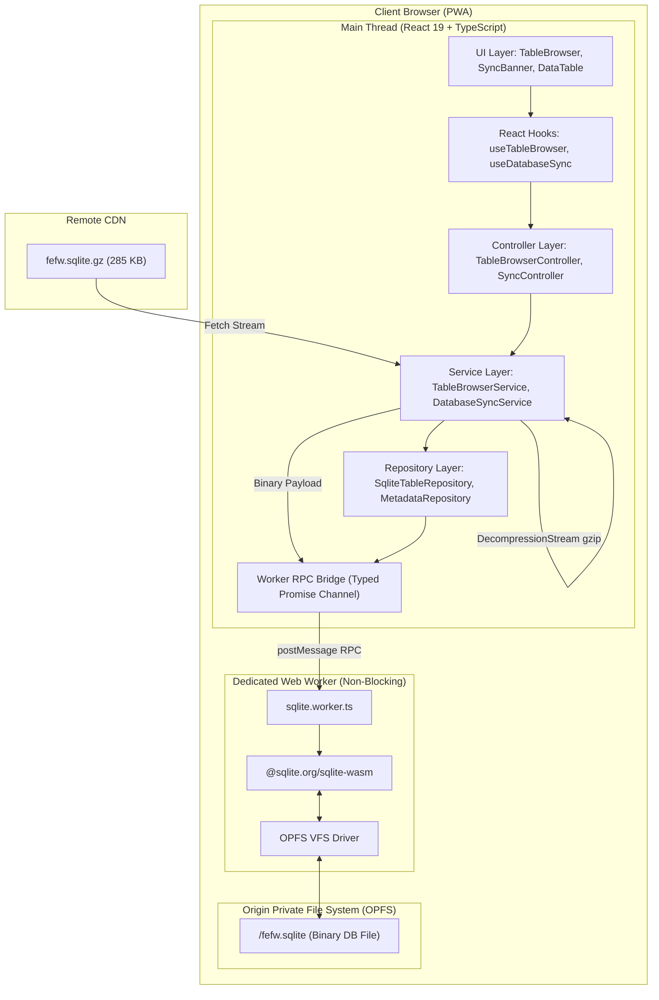

# Architecture Plan: React PWA Foundation with SQLite WASM (OPFS)

This document outlines the architectural blueprint, data flow, in-browser layered backend, and user interface for the **Fire Emblem: Fortune's Weave** React application foundation. The app downloads a compressed SQLite database archive from a CDN, stores and mounts it persistently using the **Origin Private File System (OPFS)** via the official **SQLite WASM Web Worker**, and provides a multi-layer (Repository $\rightarrow$ Service $\rightarrow$ Controller) API architecture with a dynamic 26-table data browser.

---

## 1. High-Level Architectural Overview



---

## 2. Technology Stack & Key Choices

| Layer | Selection | Rationale |
| :--- | :--- | :--- |
| **Bundler & Build Tool** | **Vite (TypeScript)** | Native Web Worker bundling (`?worker`), fast HMR, native top-level await and WASM asset handling. |
| **UI Framework** | **React 18 / 19** | Strict component-level lifecycle, concurrent rendering, and clean hook boundaries. |
| **Styling** | **CSS Modules / Vanilla CSS** | Zero external CSS dependencies, scoped component styling, lightweight production bundle. |
| **Database Engine** | **`@sqlite.org/sqlite-wasm`** | Official modern SQLite engine with OPFS VFS support, running in a Web Worker to keep the 60fps main UI thread unblocked. |
| **Client Persistence** | **OPFS (Origin Private File System)** | High-performance random read/write storage native to modern browsers; persists across app launches and offline sessions. |
| **Decompression** | **Browser `DecompressionStream('gzip')`** | Native streaming gzip decompression (zero third-party libraries needed, handles the 285 KB CDN payload instantly). |

---

## 3. Layered In-Browser Backend Architecture

To keep the application robust, testable, and ready for future complex features (such as team building, damage calculation, and inventory optimization), the codebase adopts an enterprise layered design:

```
src/
├── app/
│   ├── App.tsx                        # Root layout with sidebar and main content
│   ├── App.module.css                 # Global shell layout styles
│   └── main.tsx                       # React application entry point
├── assets/
│   └── styles/                        # Design tokens, reset, typography, theme variables
├── core/
│   ├── config/
│   │   └── database.config.ts         # Hardcoded CDN URL, DB filename, OPFS paths
│   ├── types/
│   │   ├── database.types.ts          # Table schema types, column metadata, table enum
│   │   ├── rpc.types.ts               # Request/Response message envelopes for Web Worker
│   │   └── api.types.ts               # Paginated response, query options, sort criteria
│   └── errors/
│       └── database.errors.ts         # Custom AppError, WorkerError, SyncError
├── backend/
│   ├── bridge/
│   │   ├── sqlite.worker.ts           # Dedicated Web Worker hosting @sqlite.org/sqlite-wasm
│   │   └── sqlite.bridge.ts           # Typed RPC bridge managing message IDs and Promises
│   ├── repositories/
│   │   ├── base.repository.ts         # Generic query executor, pagination, and parameter binding
│   │   ├── table-browser.repository.ts# Dynamic schema inspection, row counts, and table data
│   │   └── metadata.repository.ts     # PRAGMA checks, user_version tracking, table list
│   ├── services/
│   │   ├── database-sync.service.ts   # CDN download, gzip decompression, OPFS file overwrite
│   │   └── table-browser.service.ts   # Data formatting, pagination math, search filtering
│   └── controllers/
│       ├── database.controller.ts     # Endpoints for sync status, trigger sync, reset DB
│       └── table-browser.controller.ts# Endpoints for listTables, getTableData, getTableSchema
├── ui/
│   ├── components/
│   │   ├── common/                    # Button, Spinner, Badge, Pagination
│   │   ├── layout/                    # Header, Sidebar, Container
│   │   └── table-browser/             # TableSelector, DataTable, SearchBar, SchemaModal
│   └── hooks/
│       ├── useDatabaseSync.ts         # Hook tracking download progress, sync status, and triggers
│       ├── useTableBrowser.ts         # Hook managing active table, table catalog, and reload
│       └── useTableData.ts            # Hook for pagination, column sorting, and search state
```

---

## 4. Web Worker & OPFS Storage Flow

### 4.1. CDN Download & Decompression Pipeline

When the user clicks **"Sync from CDN"** (or during first boot if no database is found):

1. **Fetch CDN Resource**:
   `DatabaseSyncService` fetches the gzip binary from `CDN_URL` (`https://.../fefw.sqlite.gz`).
2. **Stream Decompression**:
   The response stream pipes into `new DecompressionStream('gzip')`.
3. **Buffer Allocation**:
   The decompressed stream yields a `Uint8Array` of the raw SQLite 3 binary (approx. 1.06 MB).
4. **Worker OPFS Mount**:
   The main thread sends `SYNC_DATABASE` with the byte array to `sqlite.worker.ts`.
5. **Atomic Overwrite**:
   The worker closes any active connection, writes the byte buffer into the OPFS `/fefw.sqlite` file, and mounts the SQLite connection with `vfs: 'opfs'`.
6. **PRAGMA Validation**:
   The worker executes `PRAGMA quick_check;` and `PRAGMA foreign_key_check;`. If valid, emits `SYNC_COMPLETE`.

### 4.2. Worker RPC Protocol

```typescript
// core/types/rpc.types.ts
export type WorkerRequestAction = 
  | 'INIT' 
  | 'SYNC_DATABASE' 
  | 'EXECUTE_QUERY' 
  | 'EXECUTE_BATCH' 
  | 'GET_SCHEMA' 
  | 'GET_TABLES';

export interface WorkerRequest<T = unknown> {
  id: string;               // UUID / incrementing sequence
  action: WorkerRequestAction;
  payload: T;
}

export interface WorkerResponse<T = unknown> {
  id: string;
  success: boolean;
  data?: T;
  error?: string;
}
```

---

## 5. Backend Layer Specifications

### 5.1. Repository Layer (`backend/repositories/`)
- **`BaseRepository`**:
  Wraps the RPC bridge. Provides standard `query<T>(sql, params)` and `queryOne<T>(sql, params)`.
- **`TableBrowserRepository`**:
  ```typescript
  export class TableBrowserRepository extends BaseRepository {
    async getTables(): Promise<{ name: string; rowCount: number }[]>;
    async getColumns(tableName: string): Promise<ColumnInfo[]>;
    async getRows(
      tableName: string, 
      options: { limit: number; offset: number; search?: string; sortBy?: string; sortOrder?: 'ASC' | 'DESC' }
    ): Promise<{ rows: Record<string, unknown>[]; totalRows: number }>;
  }
  ```
- **`MetadataRepository`**:
  Queries `sqlite_master` and PRAGMA pragmas (`table_info`, `foreign_key_check`).

### 5.2. Service Layer (`backend/services/`)
- **`DatabaseSyncService`**:
  Orchestrates network retrieval, abort controllers for cancellation, byte progress reporting, native gzip decompression, and handoff to the worker.
- **`TableBrowserService`**:
  Enforces whitelist validation on table names (preventing arbitrary SQL injection in dynamic table browsing), translates human search filters into parametrized SQL clauses, and formats date/JSON columns.

### 5.3. Controller Layer (`backend/controllers/`)
Exposes clean, framework-agnostic APIs consumed by React hooks:
- **`DatabaseController`**:
  - `checkStatus(): Promise<{ initialized: boolean; sizeBytes: number; tableCount: number }>`
  - `syncFromCdn(url?: string): Promise<SyncResult>`
  - `verifyIntegrity(): Promise<{ valid: boolean; errors: string[] }>`
- **`TableBrowserController`**:
  - `listAllTables(): Promise<TableSummaryDto[]>`
  - `fetchTablePage(req: TablePageRequest): Promise<TablePageResponse>`
  - `fetchTableSchema(tableName: string): Promise<TableSchemaDto>`

---

## 6. Frontend UI Specification

### 6.1. Layout Structure
1. **Top Application Bar**:
   - App title: *Fire Emblem: Fortune's Weave Explorer*.
   - **Database Status Indicator**: (🟢 Connected (OPFS) / 🟡 Syncing... / 🔴 Not Initialized).
   - Last Sync timestamp badge.
   - **"Sync from CDN"** primary action button with loading spinner.
   - Integrity check indicator (0 FK errors).

2. **Left Navigation Sidebar (Tables Directory)**:
   - Search filter for table names.
   - List of all **26 Normalized Tables** grouped by domain:
     - *Characters & Social* (characters, recruitment, growths, recommendations, gifts, bird time, supports)
     - *Classes & Combat* (classes, abilities, class_abilities, character_abilities, combat_arts)
     - *Equipment & Spells* (weapons, spells, items)
     - *Quests & Story* (quests, quest_rewards, paralogues, story_routes, story_chapters)
     - *Game Mechanics* (milestones, blessings, mounts, baths, terrain, trials)
   - Live row count badge next to each table name.

3. **Main Content View (Data Grid & Tools)**:
   - Header with active table name and total records count.
   - Action controls:
     - Search input (filters across text fields).
     - Page size selector (`10`, `25`, `50`, `100`).
     - **"Reload Table"** button (re-executes the query without re-downloading CDN file).
     - **"View Schema"** modal trigger (displays column names, data types, nullability, PK/FK flags).
   - Data Table:
     - Sticky column headers with sort indicators (asc/desc).
     - Cell rendering with truncation for long strings / JSON blobs.
     - Clickable row inspect drawer / modal for wide records.
   - Bottom Pagination Controls:
     - Page navigation (`First`, `Prev`, page buttons, `Next`, `Last`).
     - "Showing X to Y of Z records".

---

## 7. Step-by-Step Implementation Phases

### Phase 1: Vite + React Scaffolding & Web Worker Setup
- Initialize Vite React TypeScript project.
- Configure `@sqlite.org/sqlite-wasm` dependency and Vite worker bundle options (`worker.format: 'es'`).
- Implement `core/types/` (`rpc.types.ts`, `database.types.ts`).
- Create `backend/bridge/sqlite.worker.ts` with OPFS initialization and `sqlite.bridge.ts` typed promise registry.

### Phase 2: Core In-Browser Backend Layers
- Implement `BaseRepository` and `TableBrowserRepository` with parametrized queries for dynamic table browsing.
- Implement `DatabaseSyncService` with streaming fetch + `DecompressionStream('gzip')`.
- Implement `TableBrowserService` with pagination and sorting algorithms.
- Implement `DatabaseController` and `TableBrowserController`.

### Phase 3: Custom React Hooks & State Management
- Implement `useDatabaseSync`: Manages downloading, decompressing, and mounting lifecycle with error handling.
- Implement `useTableBrowser`: Manages table selection and metadata listing.
- Implement `useTableData`: Handles query debounce, pagination, sorting, and manual reload.

### Phase 4: UI Components & Styling
- Build modular CSS components: `Header`, `Sidebar`, `TableSelector`, `DataTable`, `Pagination`, `SyncBanner`.
- Build `SchemaModal` to show table schema definitions.
- Assemble root `App.tsx` layout.

### Phase 5: Verification & End-to-End Testing
- Test initial boot when OPFS is empty (auto-trigger or prompt sync).
- Test manual CDN sync and verify OPFS persistence after browser reload.
- Test table browsing across all 26 tables (verify slugified keys like `archer`, `theodora`).
- Test search, column sorting, pagination, and the table reload action.

---

## 8. Verification Checklist

- [ ] Web Worker successfully spins up and initializes SQLite WASM in OPFS without main-thread jank.
- [ ] Gzip archive (`fefw.sqlite.gz`) successfully downloads from CDN URL and decompresses via `DecompressionStream`.
- [ ] Database persists in OPFS across hard page reloads (F5) without re-downloading.
- [ ] All 26 tables are listed with correct row counts matching our scraped database (4,438 records).
- [ ] Table browser supports pagination, sorting, search, and reload.
- [ ] Repository $\rightarrow$ Service $\rightarrow$ Controller boundaries are clean and strictly decoupled from React UI.
